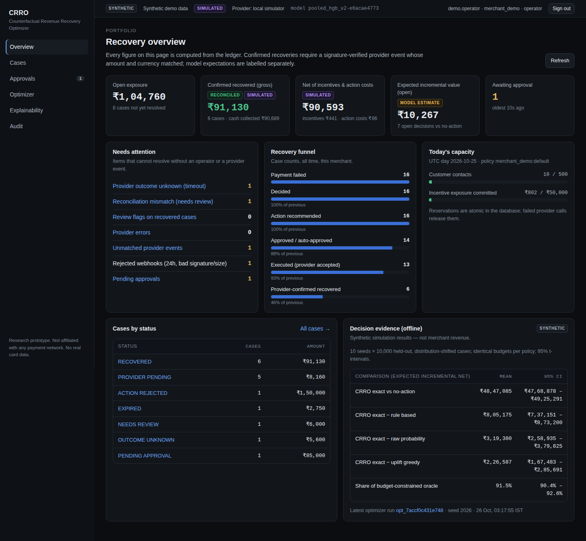
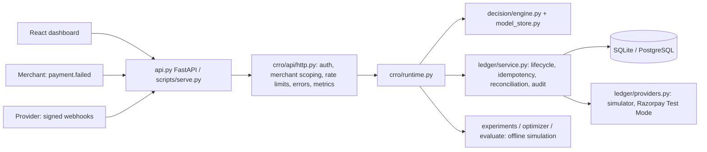
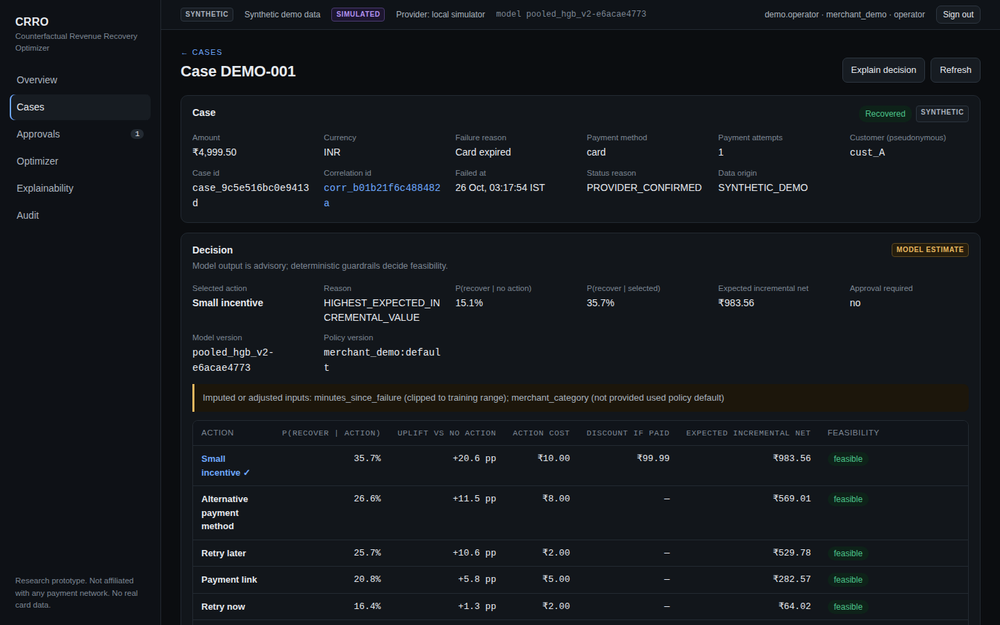
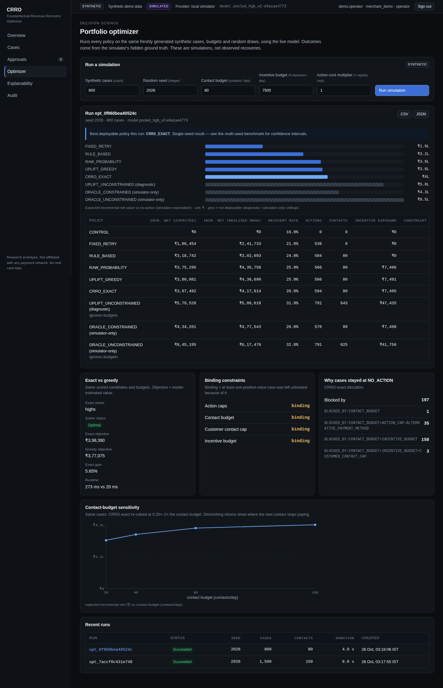
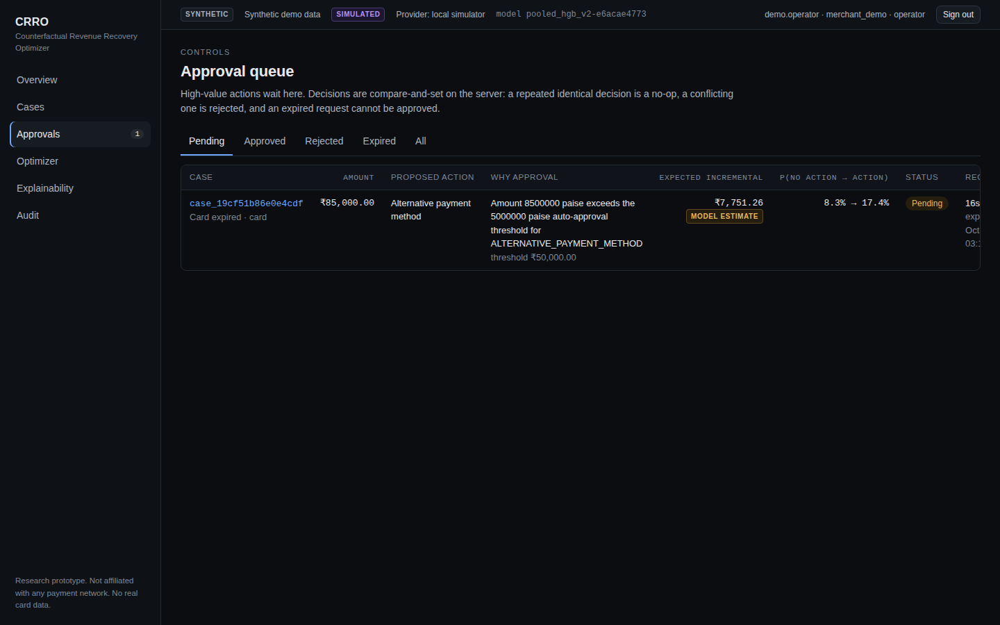
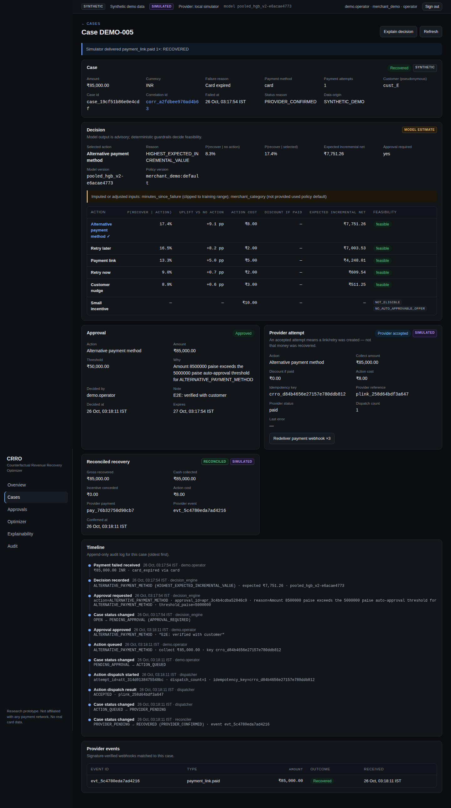
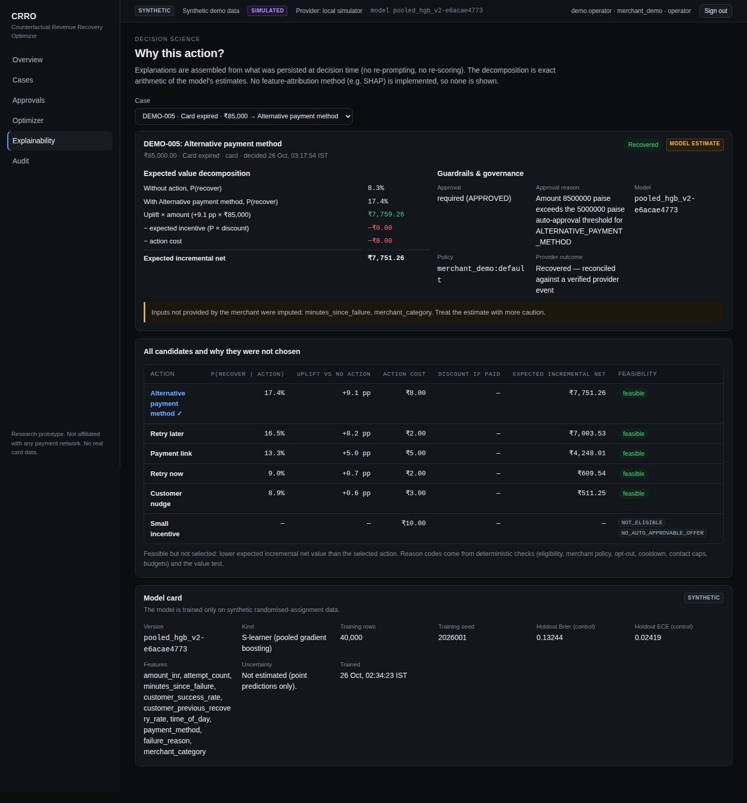
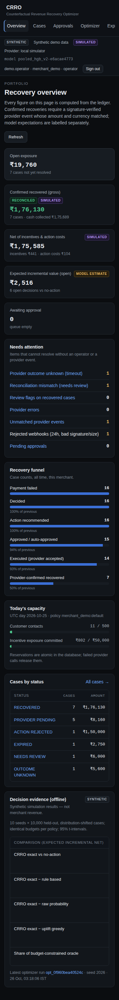

# CRRO — Counterfactual Revenue Recovery Optimizer

A payment-recovery decisioning and portfolio-optimization **research prototype**: it decides which
failed payments to act on, and how, by estimated *incremental* value under budget and policy
constraints, then executes through an idempotent provider layer and only counts money as recovered
after a verified, reconciled provider event.

> **Status (verified in this repository):** synthetic data only · local simulated provider ·
> SQLite · standard-library HTTP transport. Written but **not executed** here: FastAPI transport,
> PostgreSQL, Docker, CI, Razorpay Test Mode. Not affiliated with Visa, Razorpay or any network;
> no PCI scope; no real-world revenue claims. See [Security and limitations](docs/SECURITY_AND_LIMITATIONS.md).



## Problem

Blind retries treat every failed payment the same. They ignore that many customers would pay
anyway (the counterfactual), that actions cost money and incentives give away margin, that contact
capacity is limited, and that "API call succeeded" is not "money recovered". A recovery system also
has to be safe under the realities of payments: duplicate and out-of-order webhooks, provider
timeouts with unknown outcomes, retries, and audits.

## Solution

```
payment.failed ─► validate + dedupe (Idempotency-Key) ─► case OPEN
   ─► model: P(recover | action) for every action and for NO_ACTION
   ─► guardrails: eligibility · merchant policy · opt-out · cooldown · contact caps · budgets
   ─► choose max expected incremental value (or NO_ACTION) ─► approval gate above thresholds
   ─► atomic budget reservation ─► provider dispatch with a stable idempotency key
   ─► signed webhook (raw-body HMAC) ─► dedupe ─► validate amount · currency · merchant
   ─► RECOVERED (or EXPIRED / STILL_FAILED / NEEDS_REVIEW)  — all in an append-only audit trail
```

## Key engineering decisions

* **Uplift, not raw probability.** `v(a) = (p_a − p_0)·A − p_a·D_a − c_a`. Under identical budgets
  the raw-probability policy loses ₹3.19 L [2.59, 3.80] per 10k synthetic cases to this objective.
* **NO_ACTION is a real option** with a real simulated outcome, not a fabricated zero.
* **Deterministic systems control money.** The model only proposes values; registry rules, merchant
  policy, budgets, approvals and provider state are authoritative. (The earlier LLM analyst is
  retired to `legacy/` and never gated money movement.)
* **Idempotency and reconciliation are database-enforced**, not in-memory: unique keys, unique
  provider event ids, `UNIQUE(case_id)` on recoveries, CHECK constraints, compare-and-set state
  transitions, append-only audit triggers. Dispatch is at-least-once with idempotent effects — not
  "exactly once".
* **Integer paise everywhere**, one pricing module shared by the optimizer, the evaluator and the
  live engine (they previously disagreed: 5% vs 2% incentive cost).
* **Framework-free core.** FastAPI and the stdlib server are ~40-line transports over one
  `HttpApp`, so the tested code path is the shipped one.

## Architecture



Details, state machine and consistency model: [docs/ARCHITECTURE.md](docs/ARCHITECTURE.md).

## Features

**Implemented and verified (tests in this repo):** durable `payment.failed` idempotency (incl. 12-way
concurrent duplicates); outbox-style dispatch with timeout-after-success and restart recovery;
raw-body webhook verification; dedupe under 16-way concurrent delivery; out-of-order and stale
event handling; amount/currency/merchant validation → `NEEDS_REVIEW`; approvals with roles, expiry
and CAS; atomic daily budgets; merchant-scoped bearer auth; rate limits; append-only audit with
correlation ids; pooled uplift model; exact MILP + greedy allocation with rejection reasons;
multi-seed evaluation; dashboard (overview, cases, case detail, approvals, optimizer,
explainability, audit) with browser tests.

**Implemented, not verified here:** FastAPI transport, PostgreSQL backend, Docker image/compose,
GitHub Actions workflow, Razorpay Test Mode adapter, OR-Tools CP-SAT backend.

**Not implemented:** background worker / scheduled sweeper, tamper-evident audit, real identity
provider, uncertainty estimates, feature attribution, LLM analyst in v1.

## Results (synthetic simulation — not merchant revenue)

10 seeds × 10,000 held-out, distribution-shifted cases; model refit per seed; identical budgets
(1,000 contacts, ₹50,000 incentive exposure) and random draws for every policy; Student-t 95% CIs.
Seeds are disjoint from those used for model selection. Full tables: [docs/BENCHMARKS.md](docs/BENCHMARKS.md).

| Policy | Incremental expected net vs no-action |
|---|---:|
| Fixed retry | ₹22.46 L [22.22, 22.70] |
| Rule-based heuristic | ₹40.42 L [40.03, 40.81] |
| Raw-probability (budgeted) | ₹45.28 L [44.23, 46.33] |
| Same uplift model, greedy allocation | ₹46.20 L [45.12, 47.29] |
| **CRRO: uplift + exact allocation** | **₹48.47 L [47.69, 49.25]** |
| Budget-constrained oracle (simulator-only ceiling) | ₹52.99 L [52.44, 53.54] |

* CRRO reaches **91.5% [90.4, 92.6]** of the constrained oracle; 0 constraint violations across all
  policies and seeds.
* Exact vs greedy: OPTIMAL at 500–20,000 cases, +5.1–7.1% objective, 11.6 s at 20k cases (1 vCPU).
* Webhook trials: 2,200 deliveries (1,600 concurrent duplicates) → 0 double-counted cases.
* API (stdlib server + SQLite, 1 vCPU, 8 concurrent clients): reads p50 ≈ 13 ms / p95 ≈ 20 ms;
  new-case decide + dispatch p50 89 ms / p95 610 ms after a profile-driven fix (was 444 / 1,190 ms).
  FastAPI/PostgreSQL latency: **not measured**.

## Dashboard

| | |
|---|---|
|  Case decision: estimates, costs, exact rejection reasons |  Optimizer: same-case policy comparison, solver status, binding constraints |
|  Approval queue with thresholds |  Failure → decision → approval → dispatch → webhook → reconciliation |
|  Expected-value decomposition + model card |  375 px layout |

All screenshots are captured by the Playwright E2E run against the running application and seeded
synthetic data. Test output: [docs/screenshots/08-tests.png](docs/screenshots/08-tests.png).

## Quick start (no Docker, no credentials)

Prerequisites: Python 3.12, Node 22.

```bash
python3 -m pip install -r requirements.txt
./demo.sh            # trains the model, builds the dashboard, starts http://127.0.0.1:8000, seeds demo data
# open http://127.0.0.1:8000 → "Use demo operator"
curl -s http://127.0.0.1:8000/health/ready
```

Manual steps: `python3 scripts/train_model.py` · `cd crro-dashboard && npm install && npm run build` ·
`CRRO_DEMO_MODE=1 python3 scripts/serve.py --dashboard crro-dashboard/dist` (or
`CRRO_DEMO_MODE=1 uvicorn api:app`) · `python3 scripts/seed_demo.py`.
Docker (unverified): `docker compose up --build`.

## Configuration

| Variable | Default | Meaning |
|---|---|---|
| `CRRO_DATABASE_URL` | `sqlite:///./crro_demo.db` | SQLite file or `postgresql://…` |
| `CRRO_PROVIDER` | `simulator` | `simulator` or `razorpay_test` (rejects non-`rzp_test_` keys) |
| `CRRO_DEMO_MODE` | unset | `1` enables documented local-demo tokens (simulator only) |
| `CRRO_OPERATOR_TOKENS` | — | `token:merchant:actor[:operator|viewer],…` (tokens ≥16 chars) |
| `CRRO_SIMULATOR_WEBHOOK_SECRET` | dev value (warns) | HMAC secret for simulated webhooks |
| `CRRO_ALLOWED_ORIGINS` | localhost:5173 | CORS allow-list |
| `CRRO_MODEL_DIR` | `outputs/model` | Model artifact + card |
| `CRRO_RATE_LIMIT_SCALE` | `1` | Benchmarks only: relax rate limits |
| `RAZORPAY_KEY_ID` / `_KEY_SECRET` / `_WEBHOOK_SECRET` | — | Test Mode only |

See `.env.example`. Never commit real credentials.

## API (selected)

All `/v1/*` routes need `Authorization: Bearer <token>`; results are scoped to the token's merchant.
Route list with auth and rate limits: `GET /openapi.json`.

```bash
TOKEN=demo-operator-token-local-only
curl -s -X POST http://127.0.0.1:8000/v1/events/payment-failed \
  -H "Authorization: Bearer $TOKEN" -H "Idempotency-Key: ord-123-fail-1" -H "Content-Type: application/json" \
  -d '{"external_payment_id":"pay_123","customer_ref":"cust_9","amount_inr":"2499.00",
       "payment_method":"card","failure_reason":"card_expired","attempt_count":1}'
# 201 {"case_id":"case_…","current_status":"PROVIDER_PENDING","selected_action":"SMALL_INCENTIVE",...}
# same key + same body → same response with Idempotent-Replayed: true; different body → 409
```

| Route | Purpose |
|---|---|
| `POST /v1/webhooks/razorpay` | Provider webhook; HMAC-SHA256 of the raw body in `X-Razorpay-Signature`, `X-Razorpay-Event-Id` required |
| `GET /v1/overview` · `GET /v1/cases` · `GET /v1/cases/{id}` | Ledger-derived portfolio and case detail (cursor pagination) |
| `GET /v1/approvals` · `POST /v1/approvals/{id}/decision` | `{decision: APPROVE|REJECT, note}`; idempotent, 409 on conflict |
| `POST /v1/attempts/{id}/resolve` | Resolve an unknown provider outcome |
| `GET/PATCH /v1/policy` · `POST /v1/customers/{ref}/opt-out` | Validated, audited merchant controls |
| `POST /v1/optimizer/runs` · `GET …/{id}` · `…/policies.csv` | Synthetic portfolio simulation |
| `GET /v1/audit` · `/v1/audit/export` · `/v1/provider-events/unmatched` | Evidence |
| `GET /health/live` · `/health/ready` · `/metrics` | Operations |

## Testing

```bash
python3 -m unittest discover -s tests -t . -v      # 94 run: 93 passed, 1 skipped (FastAPI not installed here)
scripts/run_e2e.sh --screenshots docs/screenshots  # 16 browser steps passed (Playwright + Chromium)
```

What the suites cover, mutation-testing results and what was not executed:
[docs/TESTING.md](docs/TESTING.md). CI runs the suite on SQLite and PostgreSQL and fails on any skip.

## Documentation

[Implementation audit](docs/IMPLEMENTATION_AUDIT.md) (24 defects: root cause, fix, regression test) ·
[Architecture](docs/ARCHITECTURE.md) · [Financial semantics](docs/FINANCIAL_SEMANTICS.md) ·
[Decision science](docs/DECISION_SCIENCE.md) · [Benchmarks](docs/BENCHMARKS.md) ·
[Security and limitations](docs/SECURITY_AND_LIMITATIONS.md) · [Testing](docs/TESTING.md) ·
[User guide](docs/USER_GUIDE.md)

## Repository structure

```
crro/            core: money, economics, model, optimizer, evaluation, ledger/, decision/, api/, runtime
api.py           FastAPI transport          scripts/   serve, seed, train, e2e, benchmarks/
crro-dashboard/  React operator console     tests/     unit/ + integration/
docs/            documentation, screenshots, benchmark raw results
legacy/          superseded code kept for traceability (not imported)
```

## Roadmap

1. Run CI on PostgreSQL; profile the write-path tail latency on PostgreSQL + uvicorn.
2. Background dispatch worker, outbox relay and scheduled reconciliation sweeps.
3. Off-policy evaluation with logged propensities; uncertainty-aware decisions.
4. Razorpay Test Mode end-to-end run; real identity provider; tamper-evident audit.

## License and contributions

No license file is included; all rights reserved by the author unless one is added. Issues and
pull requests are welcome; run the test suite and keep benchmark claims tied to `docs/benchmarks/results`.
