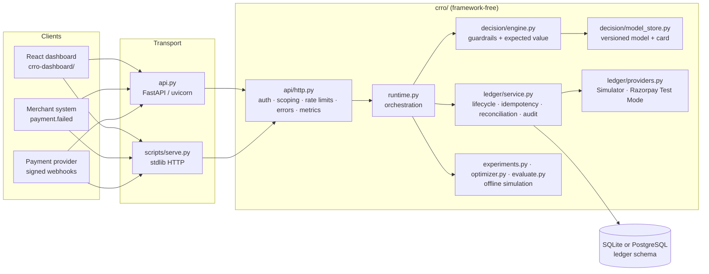
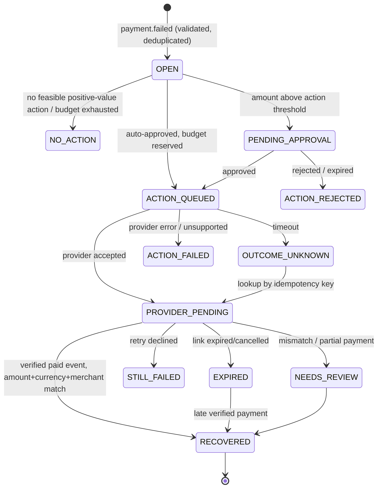

# Architecture

CRRO is a single Python service plus a React operator console. All business behaviour lives in
framework-free modules; HTTP frameworks are thin transports.

Verified runtime path in this repository: `scripts/serve.py` → `HttpApp` → `RecoveryRuntime` →
SQLite. `api.py` uses the identical `HttpApp` but was not executed in the build environment.

## Module map

| Module | Responsibility |
|---|---|
| `crro/money.py` | Integer paise, Decimal conversion, INR formatting, currency validation |
| `crro/economics.py` | The only place actions are priced (cost, discount, expected value) |
| `crro/ledger/db.py` | DB-API wrapper (SQLite/psycopg2), transactions, unique-violation mapping |
| `crro/ledger/schema.py` | Migrations (one authority for both engines), append-only audit triggers |
| `crro/ledger/states.py` | Case state machine; `RECOVERED` has no exits |
| `crro/ledger/service.py` | Intake, decisions, approvals, budget reservation, dispatch, webhooks, reconciliation, queries |
| `crro/ledger/providers.py` | Provider contract; durable simulator; Razorpay Test Mode adapter |
| `crro/decision/engine.py` | Per-case scoring + deterministic guardrails + approval threshold |
| `crro/decision/model_store.py` | Train / persist / hash-verify the model and its card |
| `crro/model.py` | Pooled S-learner (default) and per-action T-learner |
| `crro/optimizer.py` | Exact (HiGHS / CP-SAT) and greedy portfolio allocation with reasons |
| `crro/experiments.py`, `evaluate.py`, `baselines.py` | Multi-policy synthetic evaluation protocol |
| `crro/api/http.py` | Routes, auth, merchant scoping, validation, errors, CORS, metrics |
| `crro/runtime.py` | Wiring + synchronous dispatch + optimizer runs + stuck-attempt sweeper |

## Lifecycle

`ACTION_QUEUED` and `OUTCOME_UNKNOWN` may also move directly to reconciliation outcomes because a
verified webhook can arrive before the post-dispatch write commits.

## Consistency model

* **One transaction per state change**, including its audit row. Injected failures roll back
  completely (`test_rollback_on_injected_failure_leaves_no_partial_state`).
* **Inbound idempotency:** `(merchant, scope, Idempotency-Key)` with a SHA-256 request hash;
  same key + same body replays the stored response; same key + different body → 409. A second
  layer, `UNIQUE(merchant_id, external_payment_id)`, dedupes the business event.
* **Outbound dispatch (outbox-style):** the attempt row (status `QUEUED`, stable key) commits
  before the provider call; a compare-and-set claims it (`QUEUED → DISPATCHING`); the result
  commits afterwards. Timeouts become `UNKNOWN` and are resolved by looking the key up at the
  provider; not found → re-dispatch with the **same** key. This is **at-least-once dispatch with
  idempotent effects**, not exactly-once delivery, and it depends on the provider honouring the key.
* **Webhooks:** signature verified over raw bytes first; then `INSERT … ON CONFLICT DO NOTHING`
  on `(provider, provider_event_id)` in the same transaction as reconciliation.
* **Money cannot be double counted:** `recoveries.case_id UNIQUE`, `provider_payment_id UNIQUE`,
  `CHECK (cash_collected + incentive = gross)`.
* **Budgets:** atomic conditional `UPDATE … WHERE used + n <= limit`; released on provider error.
* **SQLite** serialises writers (`BEGIN IMMEDIATE`, WAL). **PostgreSQL** uses `SELECT … FOR UPDATE`
  and CAS updates under READ COMMITTED (not executed here).

## Data model (ledger tables)

`payment_cases`, `case_decisions` (one per case), `approval_requests`, `action_attempts` (one per
case, unique idempotency key and provider reference), `provider_events`, `webhook_rejections`
(hash + size only, no payload), `recoveries`, `budget_usage`, `idempotency_keys`,
`customer_contact_state`, `merchant_policies` (versioned), `audit_log` (append-only, triggers),
`optimizer_runs`, `sim_provider_objects` (the simulator's own "remote" store).

## Operations

* `GET /health/live` (process) and `GET /health/ready` (DB ping + model loaded) are distinct.
* `GET /metrics`: request counts and latency histograms per route, webhook duplicates, rate
  limiting, optimizer runs, gauges for approval backlog, unknown outcomes, pending reconciliation,
  unmatched events and rejections.
* Logs are JSON lines with request id, route, status, latency and merchant id; no bodies or secrets.
* Stuck work: `RecoveryRuntime.resolve_stuck()` finishes `QUEUED` attempts and resolves `UNKNOWN`
  or stale `DISPATCHING` ones; `POST /v1/attempts/{id}/resolve` does it for one attempt. Unmatched
  provider events are listed at `/v1/provider-events/unmatched` and in the dashboard.
